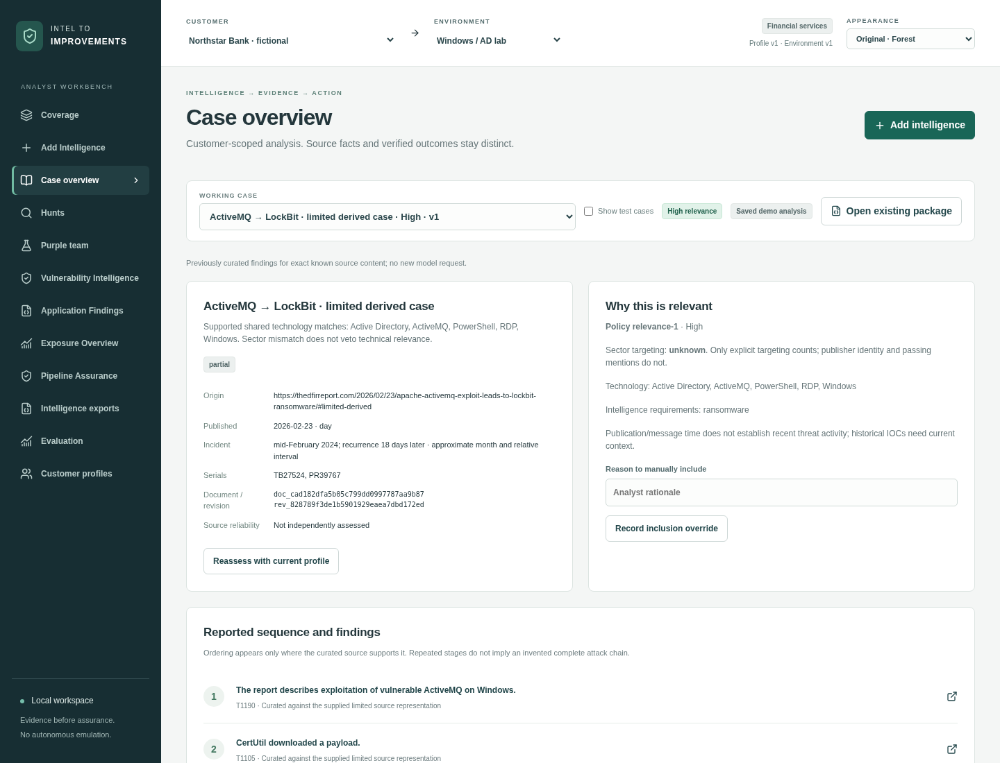
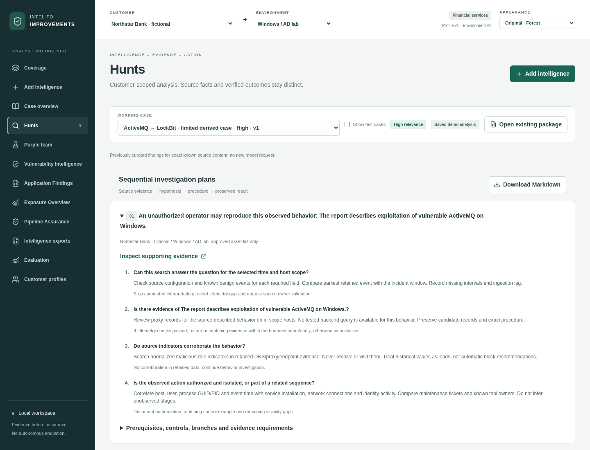
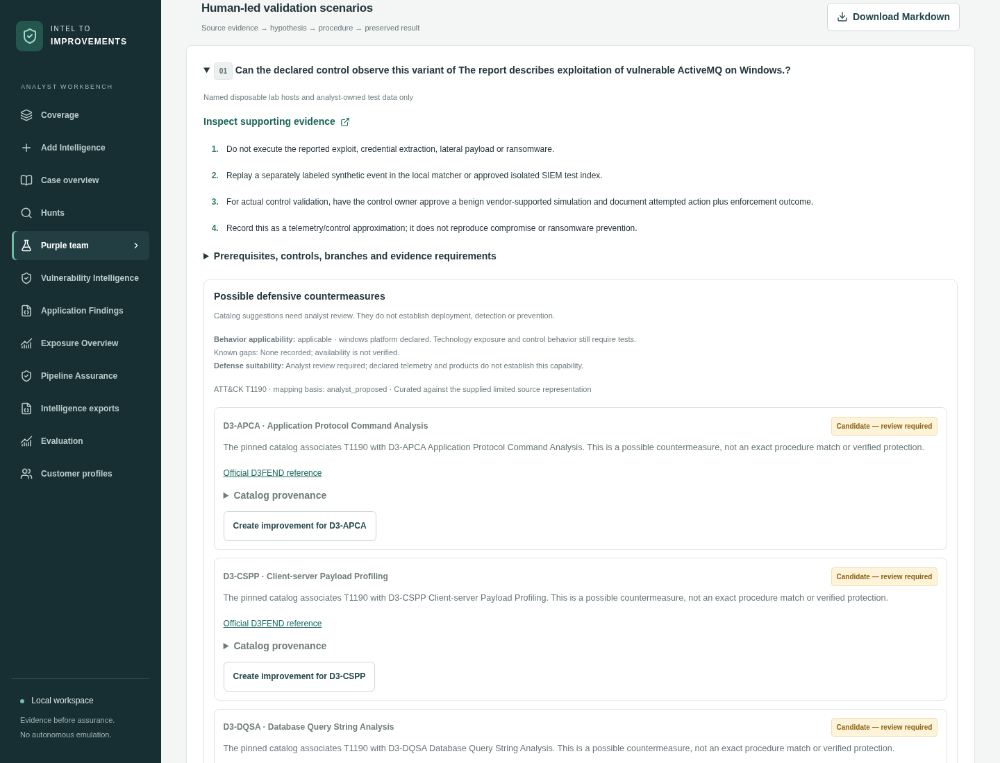
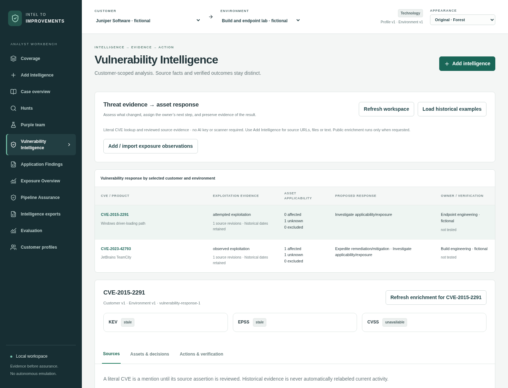
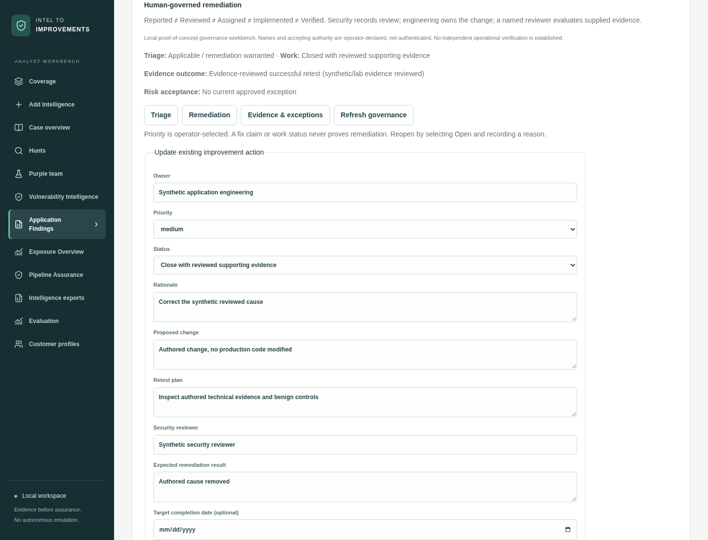
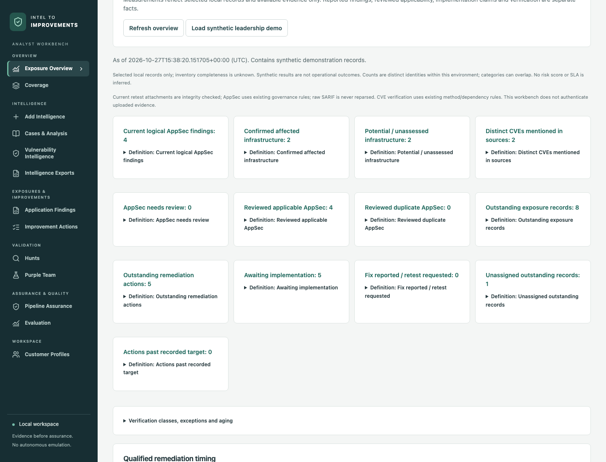
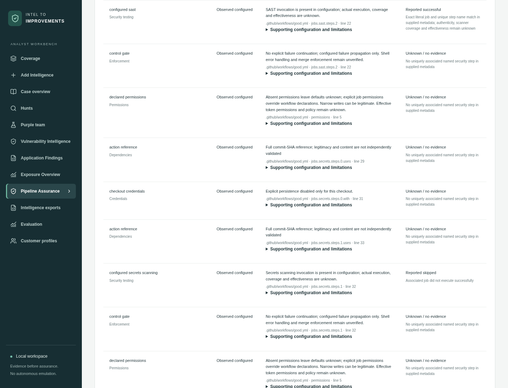
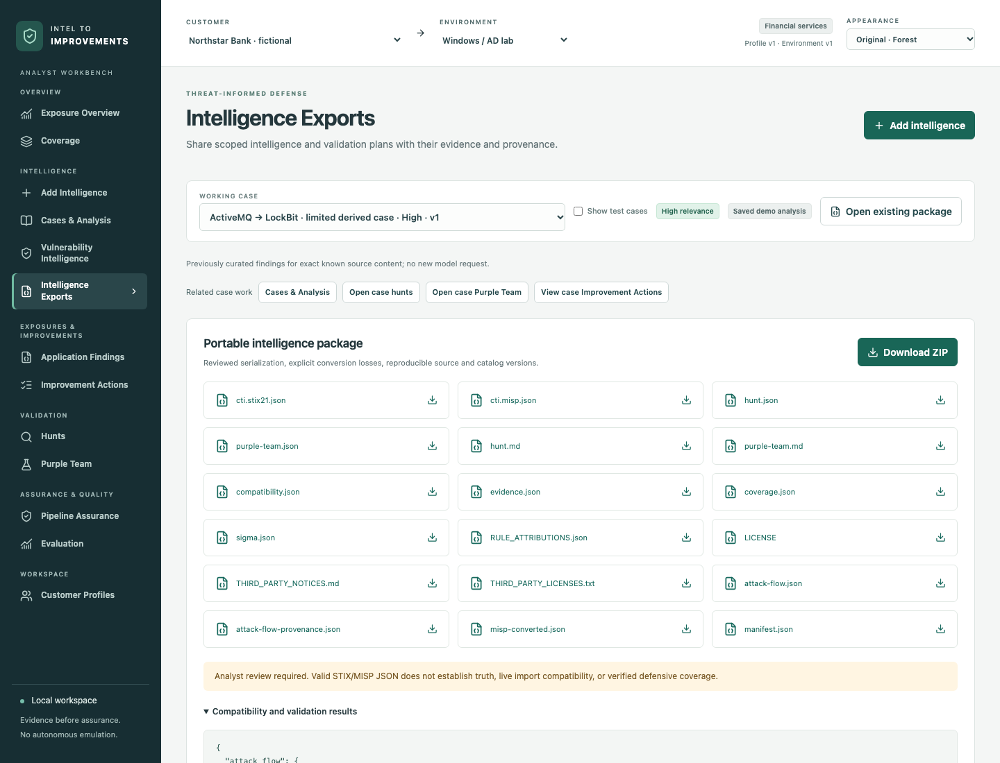

# Intel to Improvements

A runnable local security workbench connecting threat intelligence to customer relevance, hunting, human-led validation and evidence-scoped improvements. It brings together CVE intelligence, non-CVE application findings, accountable remediation, an exposure overview and CI/CD pipeline assurance. Each workspace preserves its source evidence and distinguishes reported claims from reviewed or verified outcomes.

The deliverable is local software, not a hosted service. It requires no credentials, Docker, SIEM or MISP server for the demonstration. Run the commands below from the repository root.

## Visual tour

The main pieces are **workspaces**: each supports a distinct analyst or governance task while sharing customer/environment scope, evidence storage and history. These are actual screenshots of the running application using fictional demo environments. CTI views use the attributed, limited ActiveMQ report replay; asset, AppSec, leadership and pipeline examples are synthetic. No screenshot represents independently verified enterprise security or remediation. Click an image for full resolution.

| Intelligence analysis | Threat hunting |
| --- | --- |
| [](docs/images/intelligence-analysis.png) | [](docs/images/threat-hunting.png) |
| Source parsing, exact evidence spans, ATT&CK mappings and customer relevance. [CTI walkthrough](DEMO.md) | Source-supported investigation plans and existing Sigma candidates; queries require human review. [Hunt/query contract](docs/SPLUNK.md) |

| Purple-team planning | Vulnerability Intelligence |
| --- | --- |
| [](docs/images/purple-team.png) | [](docs/images/vulnerability-intelligence.png) |
| Bounded lab scenarios, Attack Flow and D3FEND suggestions. No autonomous emulation. [Demo](DEMO.md#attack-flow-addition) | Source-linked CVEs, dated KEV/EPSS/CVSS and reviewed asset decisions. [CVE demo](docs/VULNERABILITY_INTELLIGENCE_DEMO.md) |

| Application Findings & remediation | Exposure Overview |
| --- | --- |
| [](docs/images/appsec-remediation.png) | [](docs/images/exposure-overview.png) |
| SARIF findings with or without CVEs, human triage, existing ledger actions, exceptions and retests. [AppSec demo](docs/APPSEC_REMEDIATION.md) | Current ownership, overdue commitments and qualified evidence states with source drill-down. [Overview demo](docs/EXPOSURE_MANAGEMENT_DASHBOARD.md) |

| Pipeline Assurance | Intelligence exports |
| --- | --- |
| [](docs/images/pipeline-assurance.png) | [](docs/images/intelligence-exports.png) |
| Manually imported Actions YAML, conservative checks, immutable history and optional supplied run/job evidence. [Pipeline demo](docs/PIPELINE_ASSURANCE.md#three-to-five-minute-offline-demonstration) | Portable STIX/MISP, hunt and validation plans, Sigma assessment and provenance. [Export workflow](#commands) |

**Evidence before assurance:** reported ≠ reviewed ≠ assigned ≠ implemented ≠ verified. For pipelines, configured ≠ executed ≠ effective. Coverage, action history and verification remain separate; no universal risk score or “secure application” badge is generated.

## Start

Prerequisites: macOS Apple Silicon or Linux, Python 3.12+, Node 22.22.2+ or 24.15+ (even-numbered supported release) and npm, network access for initial package installation. The current workbench was validated on Linux with Python 3.12.14 and Node 24.19.0. Earlier Apple Silicon macOS and pinned Attack Flow Builder validation are recorded in [VALIDATION.md](VALIDATION.md). Native Windows installation is not currently supported or tested; the launcher and process locks use macOS/Linux conventions.

```sh
./scripts/bootstrap
./scripts/iti demo
./scripts/run
```

Open **http://127.0.0.1:8000**. The run command bootstraps a missing installation automatically; subsequent starts are local. Health: `curl http://127.0.0.1:8000/health`. Interactive API documentation: `/docs` (the restrictive CSP may block the external Swagger assets; the machine-readable `/openapi.json` remains available).

All Python dependencies are in `.venv`; `uv.lock` and `web/package-lock.json` pin installations. Build/install caches, raw articles, database, model responses and generated working packages stay under ignored `runtime/`. No credential files are read except explicitly configured `.env`/environment variables. The runtime database contains sensitive selected source material: protect it like your research files.

For an existing installation, update the checkout from `main` and rerun `./scripts/bootstrap` to install locked dependency updates and rebuild the frontend. Command-line users should restart `./scripts/run`; the current Mac launcher identifies and replaces a stale server from the same checkout when reopened. Existing runtime data is retained; no database reset is required.

## Desktop launcher and icon

On macOS, after bootstrap, run `./scripts/install-desktop`. This installs **Intel to Improvements.app** on your Desktop with the shield/ascending-arrow icon. Double-click it to start the loopback server if needed and open your default browser. It reuses the server only when its checkout and build identity match. After an update, it safely restarts a stale server only when macOS confirms that listener belongs to the same checkout; it never stops an unrelated service on port 8000. Closing the browser leaves the server running. Startup logs are in `runtime/launcher.log`. Reinstall after moving the checkout. `./scripts/install-desktop --build-only` builds the same app in `runtime/desktop/` without writing to Desktop. Linux users can run `./scripts/run` and bookmark the local URL. The web interface includes a matching SVG favicon and Apple touch icon.

To refresh an existing Mac installation after pulling the repository, run `./scripts/bootstrap && ./scripts/install-desktop` from the current checkout, then reopen the Desktop app. This rebuilds the frontend and rewrites the app bundle's absolute checkout path. Existing SQLite data and immutable evidence under `runtime/` are retained.

## Appearance

Use the **Appearance** dropdown in the top bar on any page: **Original · Forest** keeps the existing design, **Ocean** uses navy/blue on light surfaces, and **Midnight** uses charcoal/violet/teal. Your choice is remembered in this browser and applies to tables, forms, drawers, and status labels. It is independent of customer selection. See [theme sources and accessibility checks](docs/THEMES.md).

## Commands

```sh
./scripts/iti demo                  # four cases plus separate macOS/cloud assessment
./scripts/iti ingest fixtures/no-ioc.md --kind path --mode offline
./scripts/iti ingest 'https://thedfirreport.com/2026/02/23/apache-activemq-exploit-leads-to-lockbit-ransomware/' --kind url --mode offline
./scripts/iti ingest '~/Downloads/report with spaces.eml' --kind path
./scripts/iti export ASSESSMENT_ID --customer fictional-bank
./scripts/iti test
./scripts/iti eval                  # writes validation/evaluation.json and .html
./scripts/iti health                # capability configuration/readiness
./scripts/iti catalog-sync          # explicit fuller public Sigma sync; restart app afterward
```

`ingest` prints the actual persisted job state, frozen context and assessment ID. `export` prints package ID and validation results. A failed live extraction exits nonzero and remains inspectable/resumable. CLI and UI call the same services.

The generated ZIP contains STIX, native MISP, converted MISP, hunt Markdown/JSON, purple-team Markdown/JSON, Sigma assessment, evidence, coverage, compatibility report and a run manifest. `examples/activemq/` contains a reusable package from the limited attributed replay; full retrieved articles are never committed.

## Coverage timing and demonstration cases

The coverage card **Receipt → first assessment** is a completed milestone: original customer receipt to the first persisted assessment in the selected environment, including any waiting time. It is not a running stopwatch. Refreshing, generating a package, or reassessing a revision does not reset it. A newly received source has its own clock. History shows original receipt, first assessment, selected-revision assessment, and package readiness separately; package creation never becomes assessment completion. Long durations display hours/days rather than thousands of seconds.

The badge **Local analysis · no AI** describes fixed rules running on this computer; it does not describe internet connectivity. URL fetching still uses the network. To request the configured model, choose **Model API analysis** in Add Intelligence before submitting the source. This requires configured `OPENAI_API_KEY` / `OPENAI_MODEL` and a customer profile allowing live processing. Results retain the method that produced them; no automatic promotion or fallback occurs. **Saved demo analysis** labels the exact-content curated replay and is available through **Load selected case** for the bundled excerpt. The full webpage has different content, so it cannot use those saved findings. URL/file/Gmail/text intake offers Local or Model API analysis. If an older job failed in saved-demo mode, its guided recovery buttons analyze the already-saved source with the method you select, retaining its original customer/environment snapshot, receipt clock and failed-job history. Model recovery still requires configuration and never silently falls back.

Bundled edge-case examples, including the insufficient-evidence note, are hidden from the working-case and demo selectors by default. **Show test cases** reveals them. They check that nontechnical text produces Unknown relevance and no invented hunt/emulation plan. The test fixtures and their records remain intact; actual user-supplied sources with insufficient evidence remain visible.

## Inputs and processing

- URL: selected public HTTP(S) report on ports 80/443, at most four redirects, connect/read timeouts and 5 MiB. Resolved IP is pinned for the request; local/private/reserved/metadata destinations are rejected at every hop. Index listing is bounded to 25 links and never auto-ingests them. Generic HTML extraction reports fallback gaps. No IOC, payload, report command or embedded URL is executed/fetched automatically.
- Local path: an explicit readable regular file on the **backend machine**, including `~`, spaces, Unicode and resolved symlinks. It does not scan directories or modify originals. Browse/upload sends bytes; it does not disclose an absolute browser filesystem path. Loopback host and origin checks protect this local-only feature.
- Files: UTF-8 text/Markdown, HTML, validated STIX 2.1 bundle, native MISP JSON, indicator CSV, `.eml`, text PDF. Image-only PDF/HTML evidence and unavailable attachments remain partial/failed; no OCR. Unknown JSON, executable uploads, encrypted PDF and unsupported formats fail visibly.
- Gmail: **Chat-connected Gmail / assisted import**, described below. No app-native Gmail connection, API, OAuth, IMAP, cookies or mailbox polling.

Modes are visible in UI and manifests:

1. **Replay:** exact content-hash lookup of developer/model-curated annotations for the limited DFIR case. It is not a new AI inference. Changed content cannot select a canned answer by title/URL.
2. **Bounded offline:** conservative text recognizers for eight Windows behavior families, deterministic IOC normalization, explicit abstention elsewhere. Useful for fixtures and intake inspection; not general AI analysis. The untuned cloud case is intentionally missed and measured.
3. **Live:** official OpenAI SDK structured outputs, configured model, no tools. Selects source spans only, enforces bounded chunks and conservative token reserve, caches validated chunks, preserves rejected/raw responses, refuses silent fallback. Evidence IDs/exact quotes are checked, but human semantic review is still necessary.

Copy `.env.example` to `.env` only when enabling optional integrations. Set `OPENAI_API_KEY` and `OPENAI_MODEL`; optional `OPENAI_BASE_URL` is an explicitly configured compatible endpoint. No assumed latest model or pricing. The default conservative token budget may reject long reports; deliberately raise `ITI_MAX_MODEL_TOKENS` after assessing source size. Optional per-token rates plus `ITI_MAX_MODEL_USD` enable a conservative pre-call cost ceiling. If rates are unavailable, cost stays unknown and token limits still apply. A ChatGPT subscription is not an API credential.

```sh
./scripts/iti ingest /absolute/path/to/unseen-report.txt --kind path --mode live
```

General live extraction is **NOT VERIFIED** in this build session; the actual selected-report attempt is saved as a failed job because API key/model configuration was absent.

## Customer profiles and relevance

Northstar Bank and Cedar Cloud are fictional. Create/edit customer name, initial sector taxonomy, requirements, priorities and multiple child environments. The default sector taxonomy has stable IDs, including Unspecified and Other/custom, and is not claimed to be an official standard. Environment JSON exposes fields, retention, technologies, assets, controls and an explicit raw Splunk map.

Each job freezes customer/environment versions, policy, source revision and MISP destination. Profile changes produce new assessments; they do not redirect running jobs, reset clocks or erase prior packages. Research can be shared explicitly through CLI/service scope; otherwise ingestion is private to the selected customer. This is local single-operator isolation, not a production multi-tenant security claim.

Policy `relevance-1`: evidenced shared technology → High even across sectors; supported platform alone → Medium; requirement match → Medium with applicability caveats; known platform mismatch without a match → Low; insufficient evidence → Unknown. Sector targeting counts only when explicitly supported. Sector mentions or publisher identity cannot force targeting. Publication/email time never establishes current intrusion activity. Recommended includes High/Medium/Unknown; All is one click away. Overrides require reasons and are logged. See `docs/RELEVANCE.md`.

## Existing Gmail plugin workflow

The owner confirms the existing plugin is configured and tested. That is distinct from this new handoff’s live acceptance status. The application deliberately uses portable files, not a runtime mailbox connection.

1. Select customer/environment. Open **Add Intelligence → Gmail**. Enter query, optional known label, dates and maximum messages (1–25).
2. **Prepare Gmail Request**, then **Copy request**. This stores an immutable request and context in SQLite.
3. Paste into a conversation with the existing Gmail plugin. The request asks for actual full returned source bodies and provenance, no summarization substitution, and read-only access. No new login/setup is requested.
4. Download the returned schema-valid JSON. The conversation need not share this Mac filesystem.
5. **Import Handoff** via file, explicit local JSON path or pasted JSON. **Preview & validate**, inspect completeness, then **Process handoff**.
6. Inspect persisted jobs, relevance and source spans, then generate the normal packages. Imported-message filtering searches only already imported local records.

CLI equivalent:

```sh
./scripts/iti gmail-request --query '"the DFIR report"' --max-messages 2 --output runtime/gmail-request.txt
# Copy the generated request into your existing connected conversation.
./scripts/iti gmail-import ~/Downloads/gmail-handoff.json --preview
./scripts/iti gmail-import ~/Downloads/gmail-handoff.json --mode offline
```

A request generated during this session is in `runtime/gmail-request.txt`; `runtime/gmail-request.json` contains its ID. Live retrieval is pending operator-selected scope; no mailbox messages were retrieved during the build. Synthetic handoff workflow completed separately. To generate a synthetic file for an existing request:

```sh
./scripts/iti gmail-sample REQUEST_ID --output runtime/synthetic-handoff.json
```

See `docs/GMAIL_HANDOFF.md` and `docs/schemas/GmailHandoff.schema.json`. Missing IDs/MIME/attachments stay null or gaps. Snippet/truncated content is partial. Exact representations are hashed with their representation label. Request mismatch and path references are rejected. Split batches retain request/batch IDs; known counts are not mailbox-total claims. Neither imported messages nor quoted forwards establish independent corroboration.

## Optional MISP import and readback

Exports need no server. The **Import / reconcile MISP** button is an explicit import action after preview; it does not publish or synchronize anything.

1. Configure `MISP_URL=https://your-instance` and `MISP_API_KEY` in `.env`; normal TLS verification is always enabled.
2. Set that exact customer’s MISP destination, save, reassess and generate a new package so the destination is frozen.
3. Inspect native event and compatibility issues. Run:

```sh
./scripts/iti misp-check PACKAGE_ID --customer fictional-bank
```

Stable identity is scoped to customer, destination and logical report. Upsert preserves unrelated attributes/tags/reports and detects changes to managed remote fields. Before retrying an uncertain write, it searches the stable UUID and reconciles readback. Results retain MISP version and differences. Organization-only/unpublished sharing is enforced. No source TLP is invented; MISP analysis status is not our validation state. Native export checks use PyMISP models and its bundled lax schema (the strict bundled schema does not include EventReport). Converter and live import are distinct results. No MISP server was available; **live import/readback NOT RUN**. Fake transport tests are not live verification.

## Validation and scope

See `VALIDATION.md`, `validation/evaluation.html`, `REQUIREMENTS_TESTS.md`, `ARCHITECTURE.md`, and `DEMO.md`. The actual evaluation includes successful cases and a held-out unsupported cloud behavior. No live SIEM, ransomware, exploit, credential theft or red-team tool is executed. The one supported query target is documented in `docs/SPLUNK.md`.

Phase 4 local regression validation: **278 backend tests and 54 frontend tests passed**, together with TypeScript checks, the production build and the repository's applicable lint/security checks. Real local Chromium acceptance exercised configuration and execution preview/confirmation, original-byte/hash downloads, mismatch rejection, immutable revisions, customer switching and mobile/theme behavior. The screenshots above were captured from the running production frontend. These checks validate workbench behavior, not the security of a supplied repository.

```sh
.venv/bin/python -m pytest -q
npm --prefix web run typecheck
npm --prefix web test
npm --prefix web run build
```

Source material is untrusted; frontend rendering uses React text nodes, not source HTML. The app binds loopback by default, denies cross-origin/cross-site requests, sets restrictive response headers and limits input sizes. It is not designed for public hosting. Back up the SQLite database and immutable blobs together. Source/model/catalog/environment hashes in manifests support reproducible exports; live model answers are not claimed deterministic.

Dependency security: [patched versions, audit results and the remaining diskcache advisory](docs/DEPENDENCY_SECURITY.md). The tested local Sigma workflow does not open that cache, but the dependency has no patched release and its advisory remains unresolved. Passing CI is not a claim that all dependencies are vulnerability-free.

Review staged content first; `.gitignore` excludes all full reports, live handoffs, secrets and runtime data. Application license and catalog/source notices are separate in `LICENSE` and `THIRD_PARTY_NOTICES.md`.

## Reported Attack Flow

The Purple team page includes the actual locally served MITRE Attack Flow Builder above the human validation scenarios. Generate an updated package to add **attack-flow.json** and its evidence/provenance sidecar. Historical packages remain unchanged. The existing ActiveMQ case is honestly unordered: its saved sequence numbers do not prove relationships.

Fresh bootstrap builds the viewer. For an existing install, run `./scripts/build-attack-flow` and `npm --prefix web run build`, then restart `./scripts/run` and refresh the page. No extra running service, internet access after setup, or AI credential is needed to view a flow. The **Open in Builder** link opens a separate editable local draft; it never overwrites or approves the immutable package. See [integration setup, pin, semantics and smoke test](integrations/attack-flow/README.md).

## Possible defensive countermeasures

Open **Purple team**, expand a scenario, and inspect **Possible defensive countermeasures**. Exact ATT&CK-ID associations come from a pinned local D3FEND catalog. **Create improvement** opens the existing editable form: choose an owner, specify a concrete control/configuration and retest, then save. The ledger retains the source evidence and frozen catalog origin; subsequent visits offer **View improvement**. The same section is available in the behavior evidence drawer.

These are suggestions requiring review. Creating, deploying or closing an action does not verify detection/prevention or stop verification clocks. No additional service, AI call, Builder install or internet access is needed for lookup. See [catalog provenance and refresh](catalogs/d3fend/README.md), [schema details](docs/SCHEMAS.md) and [validation](VALIDATION.md).

## Vulnerability Intelligence

For one connected demonstration across all workspaces, open **Add Intelligence → Open PHP2Shell working case**. It creates/selects **Harborlight Capital · PHP2Shell fictional demo**, a fictional investment firm, with attributed CTI, hypothetical ATT&CK Flow, D3FEND improvements, hunts, purple-team plans, CVE response, AppSec commitments/exceptions, exposure drill-downs and pipeline configuration/execution examples. Expand its case guide for the twelve-workspace walkthrough and downloadable inputs. Reopening preserves edits; all firm data and results are synthetic. See [the complete PHP2Shell working case](docs/PHP2SHELL_WORKING_CASE.md). Choose **Golden Ledger** in Appearance for the yellow-led investment-workbench palette.

Open **Vulnerability Intelligence** for source-linked CVEs, dated KEV/EPSS/CNA-CVSS enrichment, a manual/CSV exposure register, explained per-asset response proposals and reviewed actions in the existing improvement ledger. No scanner or AI credential is required. **Load historical examples** explicitly selects a fictional software company with TeamCity and BYOVD cases; real historical reporting and synthetic asset observations remain labeled separately.

Review the evidence, accept/override the recommendation with a reason, then create an owner action and record scoped verification. Remediation and prior-compromise hunting stay separate; closure, synthetic results and attestations cannot become live verified remediation. See the [three-minute walkthrough, CSV contract, policy, provenance and limitations](docs/VULNERABILITY_INTELLIGENCE_DEMO.md). Run `npm --prefix web run build`, restart `./scripts/run`, and refresh an existing install to load this view.

## Application Findings and AppSec remediation

Open **Application Findings**, select an existing customer/environment and upload a manually supplied **SARIF 2.1.0** file (up to 4 MiB / 1,000 results). Optionally enter application/repository/commit context, preview the findings and warnings, then explicitly confirm import. Findings can have a CWE, a CVE, or neither. Original bytes and hashes remain immutable; exact repeat imports are idempotent within their scope. Start with the clearly synthetic CodeQL- and Semgrep-shaped files in `fixtures/application-findings/`. See [import fields, provenance and limitations](docs/APPLICATION_FINDINGS.md).

Message normalization v2 expands direct and referenced message arguments and preserves escaped braces. Existing imports remain unchanged; explicit reimport after a normalizer upgrade creates a separate batch and can require renewed review. See [normalizer versions and historical evidence](docs/APPLICATION_FINDINGS.md#message-normalization-versions).

Inspect a finding and use the **Human-governed remediation** section:

1. **Triage:** record the security reviewer, disposition and reason. New findings need review.
2. **Remediation:** create an engineering commitment in the existing improvement ledger, with an owner, corrective action and retest plan. A fix claim remains **Fix reported / verification pending**.
3. **Evidence & exceptions:** preserve supporting attachments, record reviewer-evaluated retests, or request a bounded risk exception and separately record an accepting authority's decision. Expired exceptions and stale or contradictory evidence remain visible with their history.

**Reported ≠ Reviewed ≠ Assigned ≠ Implemented ≠ Verified.** An attestation, accepted risk, or absence from a later SARIF report does not establish a fix. Closure requires current reviewed supporting evidence and remains qualified as supplied/synthetic evidence review. Named reviewers and authorities are operator-declared. This local proof of concept does not authenticate enterprise approvals, execute scanners, remediate code, or independently verify operational outcomes.

For a three-to-five-minute demonstration, click **Load synthetic remediation demo**. It selects a separate fictional Juniper Software scope with reviewed remediation, an unresolved finding, active/expired/unapproved exceptions and a contradictory retest. Follow the [Phase 2 walkthrough and evidence semantics](docs/APPSEC_REMEDIATION.md). For an isolated demo using its own runtime data and blocking non-loopback network calls:

```sh
npm --prefix web run build
.venv/bin/python scripts/appsec-offline-smoke
# Open http://127.0.0.1:8002; stop with Ctrl-C.
```

## Exposure Overview

The **Exposure Overview** leadership workspace summarizes selected customer/environment records: reported findings, reviewed applicability, ownership, overdue commitments, exceptions and qualified verification. Every metric has a definition and a drill-down to its underlying records. Historical occurrences do not inflate current AppSec findings; source-only CVE mentions remain distinct from asset exposure.

Choose **Load synthetic leadership demo** to explore an isolated fictional Juniper scope with open work, pending/failed/inconclusive retests, current and stale evidence, and active/expired/unapproved exceptions. Synthetic or supplied-evidence review does not become independently verified operational remediation. Timing is shown only for eligible records and is not a claim of enterprise risk reduction. See [metric definitions and three-minute demonstration](docs/EXPOSURE_MANAGEMENT_DASHBOARD.md).

## Pipeline Assurance

Open **Pipeline Assurance** to inspect manually supplied GitHub Actions YAML. Enter operator-provided repository/ref and optional application/commit context, choose files, preview the deterministic observations and explicitly confirm. Snapshot history preserves original bytes, SHA-256 hashes, frozen customer/environment context and the assessment rule version. No scanner, GitHub credential, network integration or additional service is needed.

The bounded checks cover declared permissions, action pinning, checkout credential handling, sensitive triggers/event interpolation, recognized security/test steps and failure-continuation configuration. External reusable workflows—including `NoCoolUserName/code-quality`—remain referenced but uninspected; downstream controls are **Unknown**, not falsely marked absent. Branch-protection enforcement and control effectiveness remain unknown.

Optionally attach supplied run/job JSON to an exact repository/workflow/ref/commit snapshot. Unique named controls can show **Reported successful**, **Reported failed**, **Reported skipped**, **Reported cancelled**, **Incomplete**, or **Unknown / no evidence**. A workflow success does not establish that every scanner ran. Uploaded metadata is never described as independently authenticated.

For a three-to-five-minute demo, select a fictional scope, enter `synthetic/juniper`, ref `main`, commit `aaaaaaaaaaaaaaaaaaaaaaaaaaaaaaaaaaaaaaaa`, and mark the snapshot synthetic. Import `good.yml`, `concerns.yml` and `shared.yml` from `fixtures/pipeline/`. Attach `run.json`, then `incomplete.json`; try the rejected `mismatch.json`, and import `revised/good.yml` to show preserved history. **These are authored evidence fixtures, not runnable production workflows.** Follow the [complete walkthrough, input envelope, control definitions and limitations](docs/PIPELINE_ASSURANCE.md).

Pipeline observations do not create AppSec/CVE findings, modify the improvement ledger, or enter exposure metrics. This phase does not execute or modify pipelines, fetch external definitions, monitor GitHub, score risk or automate remediation.
